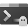
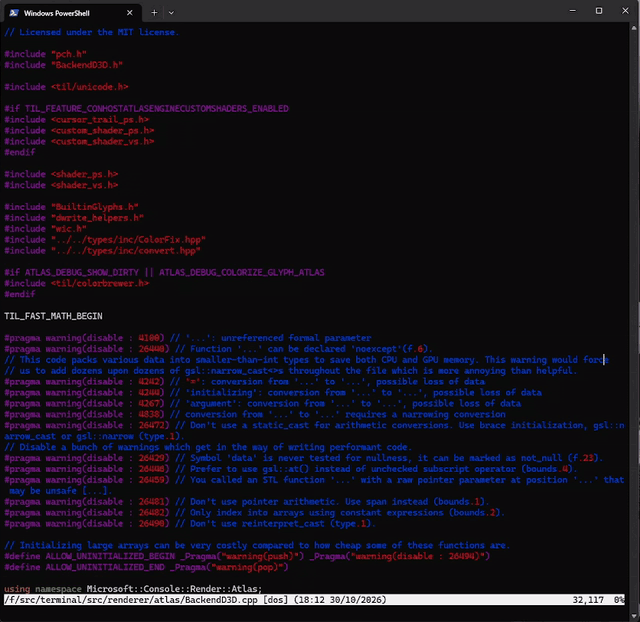
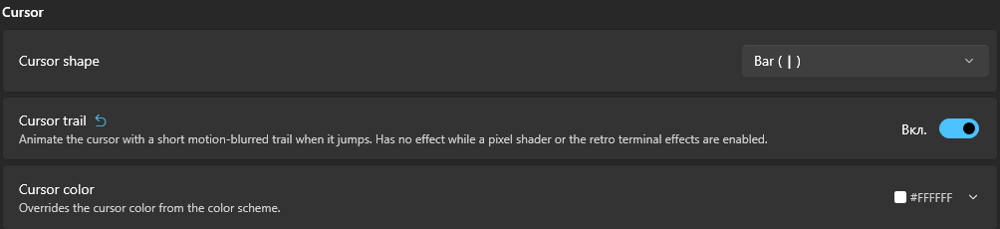

<p align="center">
  
</p>

# Terminal Trail: Windows Terminal with an animated cursor trail

A fork of [Windows Terminal](https://github.com/microsoft/terminal) that adds a smooth
**cursor trail** (cursor smear / cursor animation) like the one in kitty, Ghostty and
Neovide. When the cursor jumps, it stretches toward the new position and the tail
catches up with motion blur.



The fork also exposes the cursor to **custom HLSL pixel shaders**, so you can write
your own cursor effects on top of `experimental.pixelShaderPath`.

- Time based animation: the trail has the same length at 60, 144 or 240 Hz, high
  refresh rates are just smoother.
- Zero idle cost: the renderer only redraws for a moment after the cursor moves,
  then goes back to sleep. A plain `Time`-based shader would redraw forever.
- Follows the cursor shape that is actually drawn (bar, underscore, block) and
  survives cursor blinking.
- Based on the latest stable Windows Terminal release, not on `main`.

## Status

| | |
|---|---|
| Built-in `cursorTrail` setting in the profile and the Settings UI | done |
| Cursor uniforms for custom shaders | done |
| Portable x64 build in GitHub Actions | done |
| Signed MSIX: default terminal and "Open in Terminal" in the Windows 11 context menu | planned |

## Try it

1. Download `terminal-portable-x64` from the latest successful
   [Build portable x64](../../actions/workflows/build-portable.yml) run
   (artifacts need a GitHub login).
2. Unzip and run `WindowsTerminal.exe`. It runs in portable mode next to your regular
   Windows Terminal and keeps its settings in the `settings` folder beside the exe.
3. Open Settings, pick a profile (or Defaults), go to Appearance and turn on
   **Cursor trail** in the Cursor section. Or in `settings.json`:



```json
"profiles": {
    "defaults": {
        "cursorTrail": true
    }
}
```

A custom pixel shader or the retro terminal effect take precedence over the setting.

To tune the look, load `CursorTrail.hlsl` from the zip as
`"experimental.pixelShaderPath"` instead and edit the constants at its top: `LEAD` and
`TAIL` are the seconds until the head and the tail arrive, `SHUTTER` controls motion
blur, `TAIL_FADE` how transparent the end of the trail gets. Save, open a new tab,
done. No rebuild needed.

## Writing your own cursor shader

Declare the extra fields at the end of the usual Windows Terminal shader constant
buffer. The layout has to match exactly:

```hlsl
cbuffer PixelShaderSettings
{
    float  Time;           // seconds, wraps around every 1000 s
    float  Scale;          // UI scale
    float2 Resolution;     // of the terminal texture, in pixels
    float4 Background;     // premultiplied rgba
    float4 CursorCurrent;  // x, y, width, height in pixels, same space as SV_POSITION
    float4 CursorPrevious; // where the cursor was before the last move
    float4 CursorColor;    // premultiplied rgba of the drawn cursor
    float  CursorElapsed;  // seconds since the cursor moved, does not wrap
};
```

- Use `pos.xy` from `SV_POSITION` for pixel coordinates; the cursor rects are in the
  same space.
- The rect is the actual cursor shape, so a bar cursor is a thin rect, not a full cell.
- If your shader reads any `Cursor*` field, the terminal keeps redrawing for one second
  after each move. Let your effect settle within that window.
- Animate from `CursorElapsed`, not from frame counts, so it looks the same on every
  monitor.

The naming follows Ghostty's `iCurrentCursor` / `iPreviousCursor` /
`iTimeCursorChange`, so GLSL cursor shaders written for Ghostty port over mostly
mechanically. Pull requests with new cursor effects are welcome: drop an `.hlsl` file
into `samples/PixelShaders`.

## How it works

- `AtlasEngine::PaintCursor` remembers the last two distinct cursor positions and when
  the cursor moved. It has to happen there and not in the D3D backend, because the
  renderer decides whether to keep redrawing in `EndPaint`, before the backend renders.
- Redrawing is driven by an animation deadline. The backend declares which inputs the
  active effect animates (`AnimatedInput`, for now just the cursor), and a change to one
  of them keeps frames coming for a second. Other animations can hook into the same
  mechanism by adding a flag.
- `BackendD3D` converts cells to pixels using the shape it actually drew and fills the
  constant buffer. The built-in trail runs through the custom shader path, whose
  offscreen texture keeps partial redraws from leaving stale pixels.
- Frames are presented with vsync (`Present1(1, ...)` on a waitable swap chain), so the
  animation runs exactly at the monitor refresh rate.

The renderer changes live in `src/renderer/atlas`, the setting in `src/cascadia`. Each is
one commit on top of the release tag.

## Building

The fork builds in GitHub Actions on `windows-latest`, see
[`.github/workflows/build-portable.yml`](.github/workflows/build-portable.yml). Locally
you need what upstream needs: Visual Studio 2026 (18.6+) with the C++ and UWP
workloads, and the Windows SDK. See [the upstream README](README.upstream.md#developer-guidance).

## Credits and license

Windows Terminal is made by Microsoft and contributors and is MIT licensed, and so is
this fork. Terminal Trail is not affiliated with or endorsed by Microsoft. Upstream
documentation is kept in [README.upstream.md](README.upstream.md).
